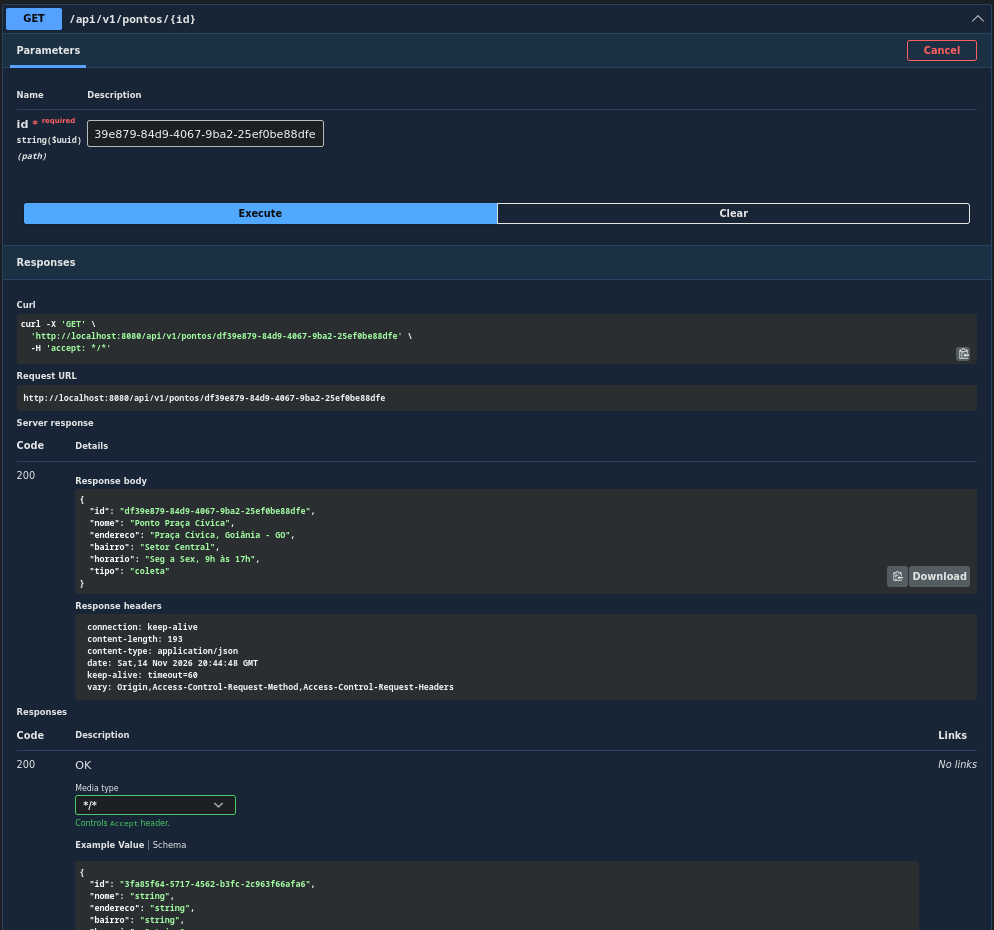
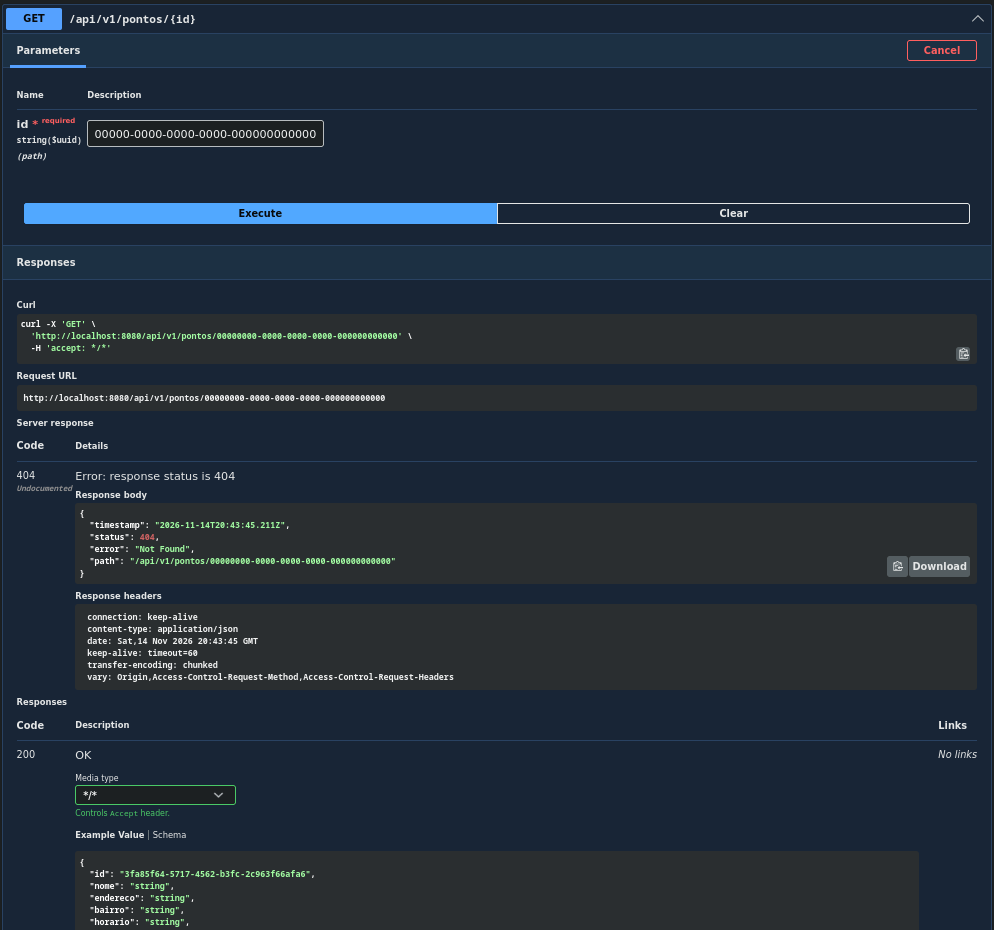
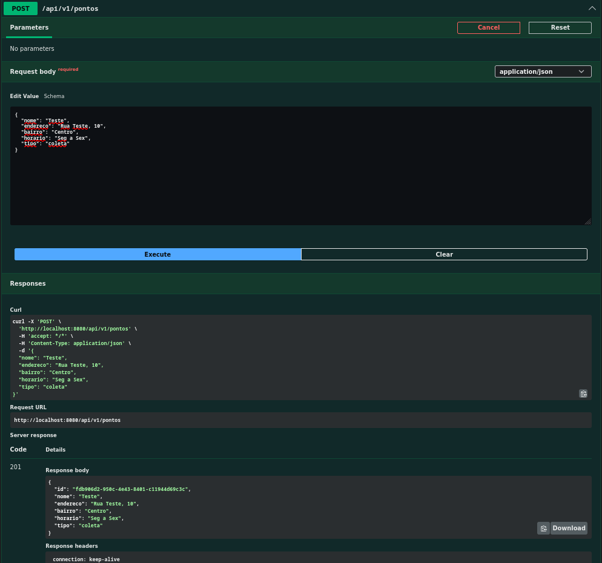

# Instituto Mão Amiga

Aplicativo mobile desenvolvido em **React Native** com **Expo** e **TypeScript** para gestão de pontos de coleta e doações.

## API

A API do Instituto Mão Amiga está no diretório `api/`. Ela é um projeto Spring Boot separado dentro deste repositório.

Requer Java 21. Para executar a API:

```bash
cd api
./mvnw spring-boot:run
```

O Swagger está disponível em `http://localhost:8080/swagger-ui/index.html`.

### Pontos de coleta (N2-1)

| Método | URL                                        | Descrição                                                                 |
| ------ | ------------------------------------------ | ------------------------------------------------------------------------- |
| GET    | `http://localhost:8080/api/v1/pontos`      | Lista todos os pontos                                                     |
| GET    | `http://localhost:8080/api/v1/pontos/{id}` | Busca por UUID; responde 404 quando não existe                            |
| POST   | `http://localhost:8080/api/v1/pontos`      | Cadastra um ponto; responde 400 se houver campo obrigatório vazio         |
| PUT    | `http://localhost:8080/api/v1/pontos/{id}` | Atualiza um ponto; responde 404 se não existir e 400 para dados inválidos |
| DELETE | `http://localhost:8080/api/v1/pontos/{id}` | Exclui um ponto                                                           |

Exemplo de corpo para POST e PUT:

```json
{
  "nome": "Ponto Praça Cívica",
  "endereco": "Praça Cívica, Goiânia - GO",
  "bairro": "Setor Central",
  "horario": "Seg a Sex, 8h às 17h",
  "tipo": "coleta"
}
```

Os pontos iniciais são gravados no H2 em arquivo e inseridos somente quando ainda não há um ponto com o mesmo nome.

### Busca paginada de pontos (N2-2)

O endpoint de filtro busca por nome ou bairro, ignorando maiúsculas e minúsculas. Sem filtro, retorna todos os pontos por página. O padrão é 10 itens, ordenados pelo nome; a URL pode sobrescrever a ordenação com `sort=bairro,asc`.

**1. Primeira página sem filtro**

```http
GET http://localhost:8080/api/v1/pontos/filtro?page=0&size=10
```

Resposta (trecho no formato `content` + `page`; a lista tem 10 itens):

```json
{
  "content": [
    {
      "id": "4e443d54-64d4-434c-992e-42f1944b20fb",
      "nome": "Ponto Bosque dos Buritis",
      "endereco": "Av. Assis Chateaubriand, Goiânia - GO",
      "bairro": "Setor Oeste",
      "horario": "Seg a Sex, 8h às 16h",
      "tipo": "coleta"
    },
    {
      "id": "5af5b5d3-265a-45ee-8c61-9dbde8e6570d",
      "nome": "Ponto Centro Comunitário Jardim América",
      "endereco": "Praça C-108, Goiânia - GO",
      "bairro": "Jardim América",
      "horario": "Seg a Sex, 8h às 16h",
      "tipo": "distribuição"
    },
    {
      "id": "0bb799cd-cba3-4760-a3cb-145e4172b2d0",
      "nome": "Ponto Centro Comunitário Leste Universitário",
      "endereco": "Rua 228, Goiânia - GO",
      "bairro": "Setor Leste Universitário",
      "horario": "Seg a Sex, 8h às 17h",
      "tipo": "coleta"
    },
    {
      "id": "8cd6193a-c786-4634-97e6-ae356ae259c4",
      "nome": "Ponto Centro Cultural Oscar Niemeyer",
      "endereco": "Av. Deputado Jamel Cecílio, Goiânia - GO",
      "bairro": "Residencial Privê dos Girassóis",
      "horario": "Qua e Sáb, 9h às 16h",
      "tipo": "coleta"
    },
    {
      "id": "d40abe15-e5ef-495f-9b11-7e9c83a6bcae",
      "nome": "Ponto Centro de Referência Campinas",
      "endereco": "Rua Benjamin Constant, Goiânia - GO",
      "bairro": "Setor Campinas",
      "horario": "Seg a Sex, 8h às 17h",
      "tipo": "coleta"
    },
    {
      "id": "1ecf072f-517e-471c-9148-0e9b1fb5a342",
      "nome": "Ponto Cmei Vila Nova",
      "endereco": "Rua do Café, Goiânia - GO",
      "bairro": "Vila Nova",
      "horario": "Seg a Sex, 8h às 16h",
      "tipo": "distribuição"
    },
    {
      "id": "6bbd16f1-8813-4295-8354-b048fe2810f6",
      "nome": "Ponto Feira do Setor Coimbra",
      "endereco": "Praça Walter Santos, Goiânia - GO",
      "bairro": "Setor Coimbra",
      "horario": "Sáb, 7h às 12h",
      "tipo": "coleta"
    },
    {
      "id": "64508df2-30b5-4481-8e0d-90a209414a70",
      "nome": "Ponto Ginásio de Campinas",
      "endereco": "Rua P-3, Goiânia - GO",
      "bairro": "Setor dos Funcionários",
      "horario": "Seg a Sex, 8h às 17h",
      "tipo": "coleta"
    },
    {
      "id": "a867cd2f-6d05-4a9d-9c8e-db578d1f7613",
      "nome": "Ponto Mercado Central",
      "endereco": "Rua 3, 322, Goiânia - GO",
      "bairro": "Setor Central",
      "horario": "Seg a Sáb, 8h às 17h",
      "tipo": "coleta"
    },
    {
      "id": "336d4cb4-d0a4-426e-8a28-7329dd0b4a37",
      "nome": "Ponto Parque Areião",
      "endereco": "Parque Areião, Goiânia - GO",
      "bairro": "Setor Pedro Ludovico",
      "horario": "Ter e Qui, 9h às 15h",
      "tipo": "coleta"
    }
  ],
  "page": {
    "size": 10,
    "totalElements": 25,
    "totalPages": 3,
    "number": 0
  }
}
```

**2. Filtrar pelo bairro**

```http
GET http://localhost:8080/api/v1/pontos/filtro?filtro=Setor%20Oeste&page=0&size=10
```

Resposta (há dois pontos nesse bairro nos dados iniciais):

```json
{
  "content": [
    {
      "id": "<uuid>",
      "nome": "Ponto Bosque dos Buritis",
      "endereco": "Av. Assis Chateaubriand, Goiânia - GO",
      "bairro": "Setor Oeste",
      "horario": "Seg a Sex, 8h às 16h",
      "tipo": "coleta"
    },
    {
      "id": "<uuid>",
      "nome": "Ponto Praça do Sol",
      "endereco": "Rua 9, Goiânia - GO",
      "bairro": "Setor Oeste",
      "horario": "Seg a Sex, 9h às 17h",
      "tipo": "distribuição"
    }
  ],
  "page": { "size": 10, "number": 0, "totalElements": 2, "totalPages": 1 }
}
```

**3. Segunda página**

```http
GET http://localhost:8080/api/v1/pontos/filtro?filtro=&page=1&size=10
```

Resposta (trecho; `content` contém os próximos 10 objetos `PontoResponseDTO` na ordem por nome):

```json
{
  "content": [
    {
      "id": "55c412aa-11bb-22cc-33dd-44ee55ff66aa",
      "nome": "Ponto Parque Cascavel",
      "endereco": "Av. do Lago, Goiânia - GO",
      "bairro": "Jardim Atlântico",
      "horario": "Qua e Sáb, 9h às 15h",
      "tipo": "coleta"
    },
    {
      "id": "77bb22cc-33dd-44ee-55ff-66aa77bb88cc",
      "nome": "Ponto Parque Flamboyant",
      "endereco": "Jardim Goiás, Goiânia - GO",
      "bairro": "Jardim Goiás",
      "horario": "Ter e Qui, 9h às 15h",
      "tipo": "distribuição"
    },
    {
      "id": "99aa33dd-44ee-55ff-66aa-77bb88cc99dd",
      "nome": "Ponto Parque Leolídio di Ramos Caiado",
      "endereco": "Av. PL-3, Goiânia - GO",
      "bairro": "Residencial Goiânia 2",
      "horario": "Ter e Qui, 9h às 15h",
      "tipo": "distribuição"
    },
    {
      "id": "11aa22bb-33cc-44dd-55ee-66ff77aa88bb",
      "nome": "Ponto Parque Mutirama",
      "endereco": "Rua 66, Goiânia - GO",
      "bairro": "Setor Central",
      "horario": "Dom, 8h às 12h",
      "tipo": "coleta"
    },
    {
      "id": "22bb33cc-44dd-55ee-66ff-77aa88bb99cc",
      "nome": "Ponto Parque Vaca Brava",
      "endereco": "Parque Vaca Brava, Goiânia - GO",
      "bairro": "Setor Bueno",
      "horario": "Sáb, 8h às 13h",
      "tipo": "coleta"
    },
    {
      "id": "33cc44dd-55ee-66ff-77aa-88bb99cc11aa",
      "nome": "Ponto Praça Cívica",
      "endereco": "Praça Cívica, Goiânia - GO",
      "bairro": "Setor Central",
      "horario": "Seg a Sex, 9h às 17h",
      "tipo": "coleta"
    },
    {
      "id": "44dd55ee-66ff-77aa-88bb-99cc11aa22bb",
      "nome": "Ponto Praça da Bíblia",
      "endereco": "Rua 202, Goiânia - GO",
      "bairro": "Setor Leste Universitário",
      "horario": "Seg a Sex, 9h às 16h",
      "tipo": "coleta"
    },
    {
      "id": "55ee66ff-77aa-88bb-99cc-11aa22bb33cc",
      "nome": "Ponto Praça da T-23",
      "endereco": "Av. T-3, Goiânia - GO",
      "bairro": "Setor Bueno",
      "horario": "Seg a Sex, 8h às 17h",
      "tipo": "distribuição"
    },
    {
      "id": "66ff77aa-88bb-99cc-11aa-22bb33cc44dd",
      "nome": "Ponto Praça do Cruzeiro",
      "endereco": "Rua 90, Goiânia - GO",
      "bairro": "Setor Sul",
      "horario": "Seg a Sex, 9h às 16h",
      "tipo": "coleta"
    },
    {
      "id": "77aa88bb-99cc-11aa-22bb-33cc44dd55ee",
      "nome": "Ponto Praça do Sol",
      "endereco": "Rua 9, Goiânia - GO",
      "bairro": "Setor Oeste",
      "horario": "Seg a Sex, 9h às 17h",
      "tipo": "distribuição"
    }
  ],
  "page": {
    "size": 10,
    "totalElements": 25,
    "totalPages": 3,
    "number": 1
  }
}
```

Para ordenar pelo bairro, acrescente `&sort=bairro,asc` à URL.

#### Prints CRUD Pontos:

> GET /api/v1/pontos
> 

> GET /api/v1/pontos/{id}
> 

> GET /api/v1/pontos/{id} - 404
> 

> POST /api/v1/pontos/ - 201
> 

> POST /api/v1/pontos/ - 400
> 

> PUT /api/v1/pontos/{id} - 200
> 

> PUT /api/v1/pontos/{id} - 404
> 

> DELETE /api/v1/pontos/{id}
> 

---

## Como Executar o Projeto

Certifique-se de ter o **Node.js** e o **npm** (ou yarn) instalados em sua máquina.

1. **Clone o repositório:**

   ```bash
   git clone [https://github.com/college-soft-eng-repos/instituto-mao-amiga.git](https://github.com/college-soft-eng-repos/instituto-mao-amiga.git)
   cd instituto-mao-amiga
   ```

2. **Instale as dependências:**

   ```bash
   npm install
   ```

3. **Inicie o projeto com o Expo:**

   ```bash
   npx expo start
   ```

4. **Abra o aplicativo:**

- Utilize o aplicativo **Expo Go** em seu celular (escaneando o QR Code exibido no terminal).
- Ou pressione `a` para abrir no emulador Android / `i` para abrir no simulador iOS (necessário ambiente Xcode/Android Studio configurado).
- Pressione `w` para rodar a versão web.

---

## Roteiro de Demonstração

Este roteiro guia a demonstração das principais funcionalidades do aplicativo durante a apresentação do projeto:

1. **Apresentação e Tela Inicial**

- Inicie o app e apresente a barra de navegação flutuante adaptativa em tema claro.
- Navegue entre os pontos de coleta e visualize os detalhes de um ponto através do modal fluído.

2. **Registro de Doação**

- Toque no botão central de ação rápida (`+`) para abrir o modal de cadastro.
- Preencha os campos de tipo de item, quantidade e selecione o ponto de destino.
- Registre a doação e observe o feedback visual de sucesso.

3. **Histórico e Filtros**

- Acesse a aba de Histórico para conferir o resumo de doações registradas.
- Utilize o campo de busca/filtro para localizar itens específicos na lista.

4. **Edição e Exclusão**

- Selecione um item do histórico para abrir a tela de detalhes da doação.
- Acione o botão de **Editar**, altere a quantidade no formulário e salve as alterações.
- Retorne aos detalhes e acione o botão de **Excluir** para remover o registro de teste.

5. **Persistência de Dados e Reinício**

- Feche o aplicativo por completo e reabra.
- Comprove que o armazenamento local mantém o histórico e os dados salvos intactos.

---

## 🛠️ Decisão Técnica de Destaque

- **Centralização do Armazenamento (`doacoesStorage.ts`):** Toda a lógica de leitura, escrita, rascunhos e exclusão foi isolada em um módulo de serviço único. Isso desacopla a camada de dados da interface (UI), garantindo alta coesão, facilidade de testes e manutenibilidade caso ocorra uma futura migração para um banco de dados embarcado.
