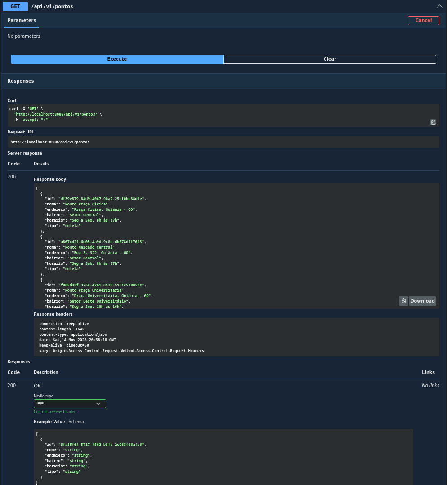
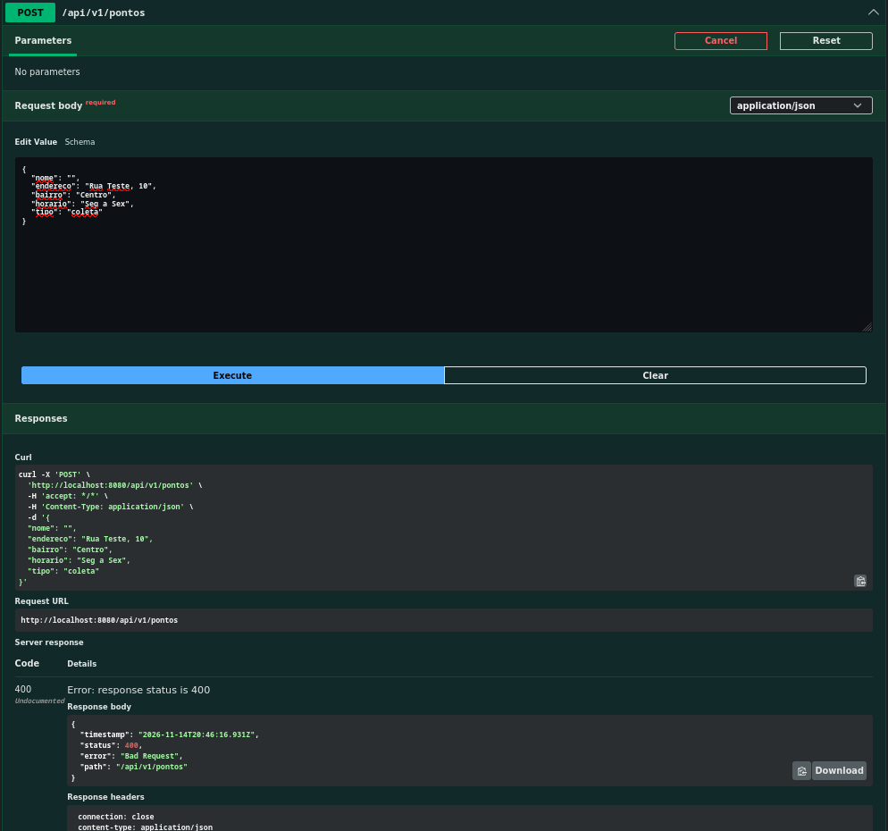
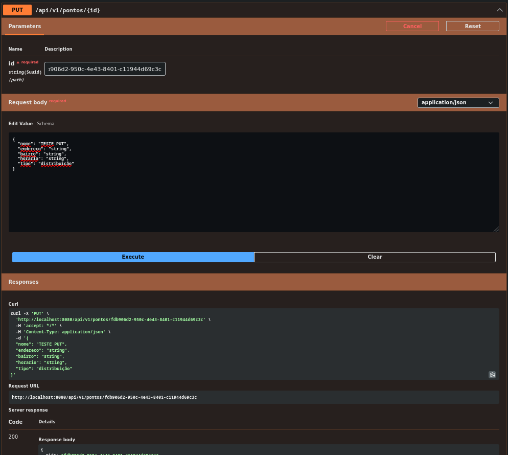
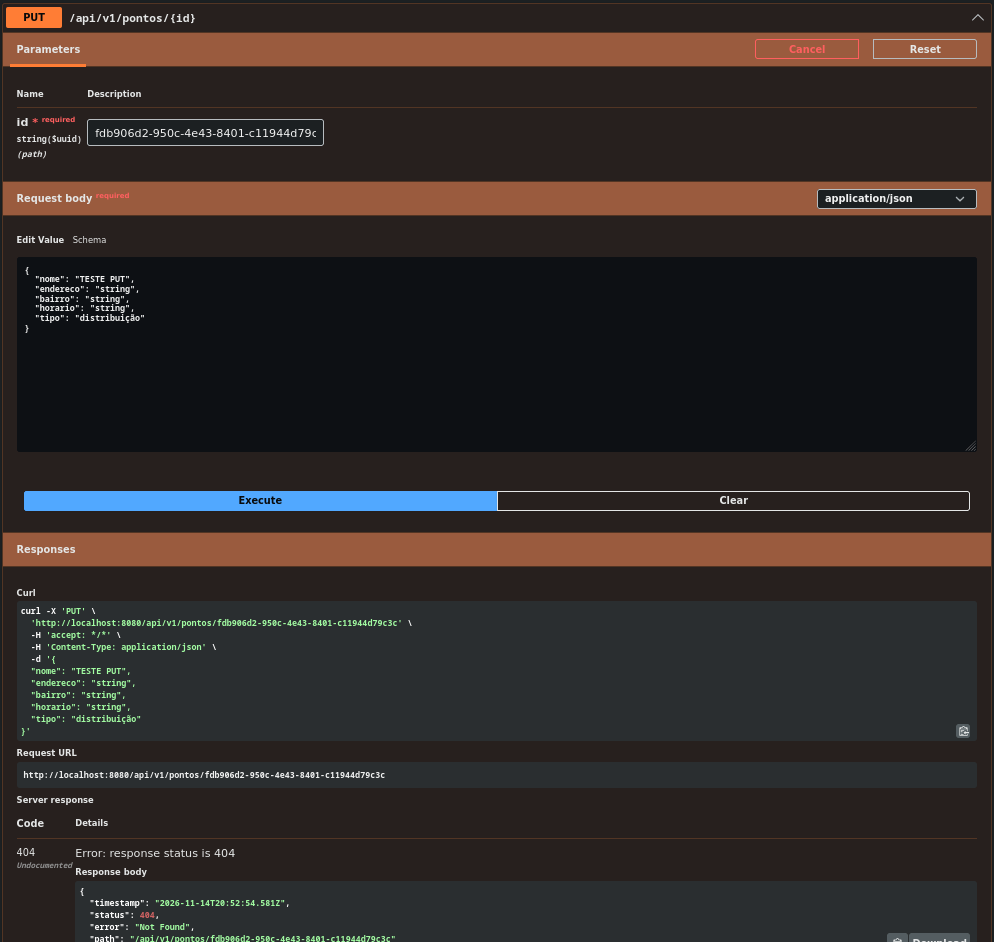
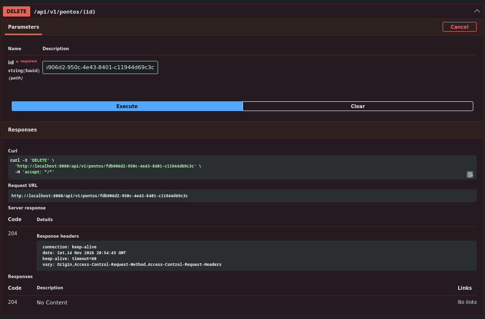

# Instituto Mão Amiga

Aplicativo mobile desenvolvido em **React Native** com **Expo** e **TypeScript** para gestão de pontos de coleta e doações.

## API

A API do Instituto Mão Amiga está no diretório `api/`. Ela é um projeto Spring Boot separado dentro deste repositório.

Requer Java 21. Para executar a API:

```bash
cd api
./mvnw spring-boot:run
```

O Swagger está disponível em `http://localhost:8080/swagger-ui/index.html`.

### Pontos de coleta (N2-1)

| Método | URL | Descrição |
| --- | --- | --- |
| GET | `http://localhost:8080/api/v1/pontos` | Lista todos os pontos |
| GET | `http://localhost:8080/api/v1/pontos/{id}` | Busca por UUID; responde 404 quando não existe |
| POST | `http://localhost:8080/api/v1/pontos` | Cadastra um ponto; responde 400 se houver campo obrigatório vazio |
| PUT | `http://localhost:8080/api/v1/pontos/{id}` | Atualiza um ponto; responde 404 se não existir e 400 para dados inválidos |
| DELETE | `http://localhost:8080/api/v1/pontos/{id}` | Exclui um ponto |

Exemplo de corpo para POST e PUT:

```json
{
  "nome": "Ponto Praça Cívica",
  "endereco": "Praça Cívica, Goiânia - GO",
  "bairro": "Setor Central",
  "horario": "Seg a Sex, 8h às 17h",
  "tipo": "coleta"
}
```

Os pontos iniciais são gravados no H2 em arquivo e inseridos somente quando ainda não há um ponto com o mesmo nome.

#### Prints CRUD Pontos:

> GET /api/v1/pontos


> GET /api/v1/pontos/{id}


> GET /api/v1/pontos/{id} - 404


> POST /api/v1/pontos/ - 201


> POST /api/v1/pontos/ - 400


> PUT /api/v1/pontos/{id} - 200


> PUT /api/v1/pontos/{id} - 404


> DELETE /api/v1/pontos/{id}


---

## Como Executar o Projeto

Certifique-se de ter o **Node.js** e o **npm** (ou yarn) instalados em sua máquina.

1. **Clone o repositório:**

   ```bash
   git clone [https://github.com/college-soft-eng-repos/instituto-mao-amiga.git](https://github.com/college-soft-eng-repos/instituto-mao-amiga.git)
   cd instituto-mao-amiga
   ```

2. **Instale as dependências:**

   ```bash
   npm install
   ```

3. **Inicie o projeto com o Expo:**

   ```bash
   npx expo start
   ```

4. **Abra o aplicativo:**

- Utilize o aplicativo **Expo Go** em seu celular (escaneando o QR Code exibido no terminal).
- Ou pressione `a` para abrir no emulador Android / `i` para abrir no simulador iOS (necessário ambiente Xcode/Android Studio configurado).
- Pressione `w` para rodar a versão web.

---

## Roteiro de Demonstração

Este roteiro guia a demonstração das principais funcionalidades do aplicativo durante a apresentação do projeto:

1. **Apresentação e Tela Inicial**

- Inicie o app e apresente a barra de navegação flutuante adaptativa em tema claro.
- Navegue entre os pontos de coleta e visualize os detalhes de um ponto através do modal fluído.

2. **Registro de Doação**

- Toque no botão central de ação rápida (`+`) para abrir o modal de cadastro.
- Preencha os campos de tipo de item, quantidade e selecione o ponto de destino.
- Registre a doação e observe o feedback visual de sucesso.

3. **Histórico e Filtros**

- Acesse a aba de Histórico para conferir o resumo de doações registradas.
- Utilize o campo de busca/filtro para localizar itens específicos na lista.

4. **Edição e Exclusão**

- Selecione um item do histórico para abrir a tela de detalhes da doação.
- Acione o botão de **Editar**, altere a quantidade no formulário e salve as alterações.
- Retorne aos detalhes e acione o botão de **Excluir** para remover o registro de teste.

5. **Persistência de Dados e Reinício**

- Feche o aplicativo por completo e reabra.
- Comprove que o armazenamento local mantém o histórico e os dados salvos intactos.

---

## 🛠️ Decisão Técnica de Destaque

- **Centralização do Armazenamento (`doacoesStorage.ts`):** Toda a lógica de leitura, escrita, rascunhos e exclusão foi isolada em um módulo de serviço único. Isso desacopla a camada de dados da interface (UI), garantindo alta coesão, facilidade de testes e manutenibilidade caso ocorra uma futura migração para um banco de dados embarcado.
